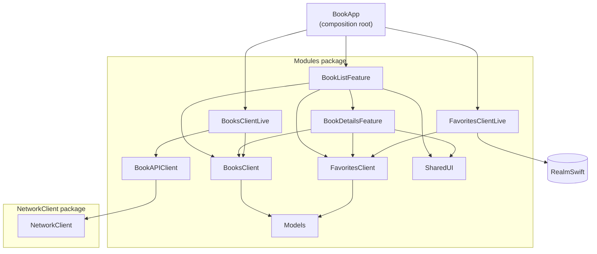

# Architecture

BookApp is a SwiftUI app built with [The Composable Architecture](https://github.com/pointfreeco/swift-composable-architecture) and split into Swift packages and modules. The reasoning behind that split is in [modularization.md](modularization.md).

## Module graph

`Models` is also used directly by features and live clients; those edges are left out for readability.

## What each module does

| Module | Does |
|---|---|
| `BookApp` | Composition root. Creates the store, injects live clients, reads the API key. |
| `BookListFeature` | Discover screen: search, categories, pagination, favorites shelf. Presents `BookDetailsFeature`. |
| `BookDetailsFeature` | Book details sheet, add/remove from shelf. |
| `BooksClient` | Interface for searching and loading book details. Has test and preview values. |
| `BooksClientLive` | Google Books implementation: requests, JSON mapping, HTML stripping. |
| `FavoritesClient` | Interface for the favorites shelf. Has test and in-memory preview values. |
| `FavoritesClientLive` | Realm implementation. The only module that imports Realm. |
| `BookAPIClient` | Google Books endpoints, response types, base URL and key. |
| `NetworkClient` | Generic HTTP: request building, status validation, JSON decoding. |
| `SharedUI` | Design tokens and reusable components. |
| `Models` | Value types shared across modules (`Book`, `Details`, `PagedBooks`, `Loading`). |

## Rules the structure enforces

- Features import client interfaces only — never a `…Live` module, Realm or `NetworkClient`.
- Live clients are chosen in exactly one place: `BookAppApp`.
- A feature may depend on a child feature it presents (BookList → BookDetails). No sibling or cyclic dependencies.
- `public` = API the app uses. `package` = shared within `Modules`. `internal` = one module only.

## Tests

Every module has a test target alongside it. `BookApp.xctestplan` runs all of them with coverage — open `BookApp.xcworkspace` or run `scripts/test.sh`.

Snapshot tests are recorded on the **iPhone 17 Pro simulator, iOS 26.5**.
