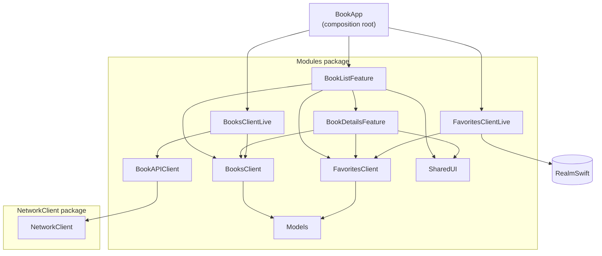

# Architecture

BookApp is a SwiftUI app built with [The Composable Architecture](https://github.com/pointfreeco/swift-composable-architecture) (TCA) and split into small Swift modules. Why it's split this way is recorded in [ADR 0001](adr/0001-modularization.md).

## Module graph

`Models` is also used directly by the features and live clients; those edges are left out for readability.

## Modules

| Module | Responsibility |
|---|---|
| `BookApp` (app target) | Composition root: creates the root store and chooses live clients. Reads the API key (`Secrets`). |
| `BookListFeature` | Discover screen: search, categories, pagination and the favorites shelf. Presents `BookDetailsFeature`. |
| `BookDetailsFeature` | Book details screen and the add/remove-from-shelf action. |
| `BooksClient` | Interface for searching books and loading details, with test and preview implementations. |
| `BooksClientLive` | Google Books implementation of `BooksClient`: requests, mapping to `Models`, HTML clean-up. |
| `FavoritesClient` | Interface for the favorites shelf, with test and in-memory preview implementations. |
| `FavoritesClientLive` | Realm implementation of `FavoritesClient`. The only module that imports Realm. |
| `BookAPIClient` | Google Books endpoints and response types, and the API's base URL and key handling. |
| `NetworkClient` | Generic HTTP client (separate package): request building, status validation, JSON decoding. |
| `SharedUI` | Design system: colors, spacing, typography and reusable components. |
| `Models` | Value types shared across modules (`Book`, `Details`, `PagedBooks`, `Loading`). |

## Rules

- **Features depend on client interfaces only.** They never import a `…Live` module, Realm or `NetworkClient`; the compiler enforces this through each target's dependencies.
- **Live implementations are chosen in one place,** `BookAppApp`. Tests override individual client endpoints; previews use each client's preview value.
- **A feature may depend on a child feature it presents** (BookList → BookDetails). Sibling and cyclic feature dependencies are not allowed.
- **Access levels:** `public` is API the app uses, `package` is shared between modules of the `Modules` package, `internal` stays inside one module.

## Testing

- Every module has a test target next to it. `BookApp.xctestplan` runs all of them with code coverage; open `BookApp.xcworkspace` or run `scripts/test.sh`.
- Known bugs are tracked as tests wrapped in `withKnownIssue`, so the suite stays green and the wrapper fails once a bug is fixed.
- Snapshot tests are recorded on the **iPhone 17 Pro simulator, iOS 26.5**; `scripts/test.sh` uses that destination.
